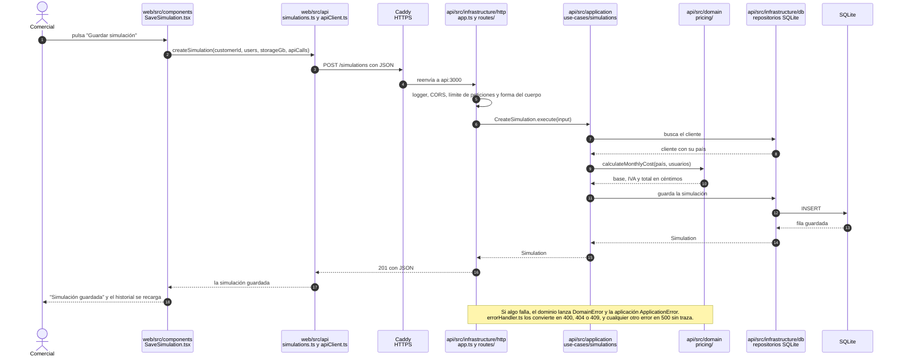

# SaaS-O-Matic

[](https://github.com/marcosAlvarezCalabria/Saas-o-matic/actions/workflows/ci.yml)

Herramienta interna para que el equipo comercial simule y presupueste suscripciones SaaS multidivisa: alta de clientes con validación fiscal, precio por tramos con IVA del país, conversión de divisa en tiempo real e historial de simulaciones.

**En vivo:** [saas-o-matic.netlify.app](https://saas-o-matic.netlify.app) · api: [saas-api.marcos-alvarez.dev/health](https://saas-api.marcos-alvarez.dev/health)

La demo tiene datos de ejemplo. Para probar la paginación y las archivadas, entra en **Nube Norte S.L.**; para el historial vacío, en **Taller Ibérico**.

&nbsp;

## Stack

- **api:** Node.js 22, TypeScript, Express 5, SQLite (better-sqlite3, sin ORM), Vitest y Supertest.
- **web:** React 19, Vite, TypeScript, Tailwind CSS 4, React Router. Sin librería de estado.
- **Monorepo** con pnpm workspaces (`api/` y `web/`).
- **Despliegue:** web en Netlify; api en Docker en un VPS de Hetzner, con Caddy para el HTTPS. CI y CD con GitHub Actions.

&nbsp;

## Arrancar en local

Requisitos: **Node.js 22** y **pnpm 10** (con `corepack enable` basta, la versión está fijada en `package.json`).

```bash
git clone https://github.com/marcosAlvarezCalabria/Saas-o-matic.git
cd Saas-o-matic
corepack enable
pnpm install
pnpm --filter api seed   # opcional: 9 clientes y 19 simulaciones de ejemplo
pnpm dev                 # api en http://localhost:3000 y web en http://localhost:5173
```

No hace falta ningún `.env`: los valores por defecto ya sirven para local (la web llama a `http://localhost:3000` y la api acepta peticiones de `http://localhost:5173`).

| Comando | Qué hace |
|---|---|
| `pnpm dev` | api y web en modo desarrollo |
| `pnpm test` | tests de api y web |
| `pnpm lint` · `pnpm typecheck` | ESLint y TypeScript en los dos |
| `pnpm build` | build de producción de los dos |
| `pnpm --filter api seed` | datos de ejemplo (no hace nada si ya hay clientes) |

### Alternativa con Docker (solo la api)

```bash
docker compose up --build -d
docker compose exec api node dist/seed.js   # opcional
pnpm --filter web dev                        # la web, como arriba
```

Los datos de SQLite viven en el volumen `api-data`, así que sobreviven a los reinicios.

### Variables de entorno

| Variable | Dónde | Por defecto | Para qué |
|---|---|---|---|
| `PORT` | api | `3000` | puerto de la api |
| `DATABASE_PATH` | api | `saas-o-matic.sqlite` | archivo de SQLite |
| `CORS_ORIGINS` | api | `http://localhost:5173` | orígenes permitidos, separados por comas |
| `TRUST_PROXY` | api | `0` | `1` si hay un proxy delante (en producción, Caddy) |
| `VITE_API_URL` | web | `http://localhost:3000` | URL de la api; se fija al hacer el build |

&nbsp;

## Guía para el evaluador

Cada requisito del enunciado, dónde verlo y qué lo comprueba.

| Requisito | Dónde se ve | Código | Tests |
|---|---|---|---|
| `POST /customers` con nombre, NIF, email, país y plan | Dashboard → "Nuevo cliente" | `api/src/application/use-cases/customers/createCustomer.ts` | `api/test/integration/customers-create.test.ts` |
| Validación fiscal con el algoritmo oficial en España (DNI, NIE, CIF) | Alta con `B12345678` → error | `api/src/domain/tax-id/spanishTaxId.ts` | `api/test/domain/tax-id/spanish-tax-id.test.ts` · `ai-workspace/01-specs/features/tax-id.feature` |
| `POST /simulations` que guarda el cálculo | Detalle → "Guardar simulación" | `api/src/application/use-cases/simulations/createSimulation.ts` | `api/test/integration/simulations-create.test.ts` |
| Precio por tramos acumulativo (15 usuarios = 140 €) | Detalle → slider | `api/src/domain/pricing/tiers.ts` | `api/test/domain/pricing/tiers.test.ts` · `ai-workspace/01-specs/features/pricing.feature` |
| IVA del país del cliente | Detalle de un cliente de FR o DE | `api/src/domain/pricing/vat.ts` | `api/test/domain/pricing/monthly-cost.test.ts` |
| Divisa dinámica con una api pública de tipos de cambio | Cabecera → selector de divisa | `web/src/api/exchangeRates.ts` · `web/src/lib/money.ts` | `web/src/api/exchangeRates.test.ts` · `web/src/lib/money.test.ts` |
| Buscador por nombre o identificador fiscal | Dashboard → buscar "nube" o "iberico" | `api/src/application/use-cases/customers/searchCustomers.ts` | `api/test/integration/customers-search.test.ts` |
| Detalle del cliente en tarjetas, con su historial | `/customers/:id` | `web/src/pages/CustomerDetailPage.tsx` | `api/test/integration/simulations-history.test.ts` |
| Slider con la factura en tiempo real | Detalle → slider de usuarios | `web/src/components/Simulator.tsx` · `POST /simulations/preview` | `api/test/integration/simulations-preview.test.ts` |
| Responsive y estados de carga y error | Las dos vistas en móvil; con la api parada | `ai-workspace/01-specs/02-interfaz.md` (secciones 4–6) | `ai-workspace/03-vibe-coding/prueba-manual.md` |
| Carpeta de trabajo con IA | `ai-workspace/` | — | — |

**Añadido sin que lo pida el enunciado:**
- archivar y recuperar simulaciones, con "Deshacer";
- paginación del historial y aviso de simulación duplicada;
- enviar una simulación por correo;
- tema claro y oscuro;
- límite de peticiones por IP;
- CORS restringido;
- datos de ejemplo;
- Docker, CI y CD.

&nbsp;

## Arquitectura y decisiones

### Recorrido de una petición

Así viaja "Guardar simulación" por las carpetas del proyecto. Cada capa solo conoce a la de debajo, y solo `errorHandler.ts` sabe de códigos HTTP.



| Capa | Carpeta | Qué hace | Conoce a |
|---|---|---|---|
| Interfaz | `web/src/components`, `pages`, `hooks` | pinta y recoge lo que hace el usuario | `web/src/api` |
| Cliente HTTP | `web/src/api` | el único sitio del front que habla con el exterior | — |
| HTTP | `api/src/infrastructure/http` | rutas, forma de la entrada y traducción de errores | `application` |
| Aplicación | `api/src/application` | un caso de uso por acción; define los puertos | `domain` y `ports` |
| Dominio | `api/src/domain` | reglas puras: tramos, IVA, NIF | nada |
| Datos | `api/src/infrastructure/db` | implementa los puertos con SQLite | `application/ports` |

- **Clean Architecture ligera** en la api: `domain/` (funciones puras, sin dependencias) → `application/` (casos de uso y puertos) → `infrastructure/` (SQLite y HTTP). Solo `main.ts` conecta las piezas. Detalle en `ai-workspace/02-architecture/00-estructura.md`.
- **El cálculo vive solo en el backend.** El slider usa `POST /simulations/preview`, que calcula sin guardar, así que el precio nunca se duplica en el front (ADR-004).
- **Importes en céntimos** (enteros) e **IVA en puntos básicos** (2100 = 21 %), para no tener errores de coma flotante (ADR-003).
- **Las simulaciones se archivan, no se borran:** son lo que se le presupuestó al cliente.
- **Sin login:** es una herramienta interna. Como la demo es pública, la api limita las peticiones por IP.

Todas las decisiones, con las alternativas descartadas, en `ai-workspace/02-architecture/adr/`. Los supuestos por ambigüedad del enunciado, en `ai-workspace/01-specs/00-analisis.md` (sección 7).

&nbsp;

## Cómo se hizo: `ai-workspace/`

| Carpeta | Qué hay |
|---|---|
| `01-specs/` | análisis del enunciado, casos de uso, interfaz, datos de ejemplo y escenarios Gherkin (`features/`) |
| `02-architecture/` | estructura, modelo de datos, contrato OpenAPI, despliegue y ADR |
| `03-vibe-coding/` | prompts a Codex en orden, bitácora de correcciones a la IA y prueba manual |
| `04-design/` | spec de diseño y capturas de la maqueta |

Método: primero la spec y su registro de cambios; después un prompt por tarea, con un solo objetivo; test antes que código en el dominio; y revisión de cada commit antes del siguiente.

&nbsp;

## Despliegue

- **Web:** Netlify, con `netlify.toml`, en cada push a `main`.
- **Api:** cada push a `main` pasa el CI (lint, tipos, tests, build e imagen Docker) y, si está en verde, se despliega en el VPS por SSH y se comprueba `/health` por HTTPS.

Detalle y pasos a mano en `ai-workspace/02-architecture/02-despliegue.md`.

&nbsp;

## Mejoras futuras

- Login, con la api solo para usuarios autenticados.
- Validar el identificador fiscal de cada país de la UE (por ejemplo, con jsvat o el servicio VIES).
- Delegar el IVA en un servicio de impuestos (inversión del sujeto pasivo entre empresas de la UE).
- Enviar el correo desde la api, en HTML, en lugar de `mailto:`.
- Borrado real de simulaciones, solo para un rol de administrador.
- Construir la imagen en el CI y subirla a un registro, en lugar de construirla en el VPS.
