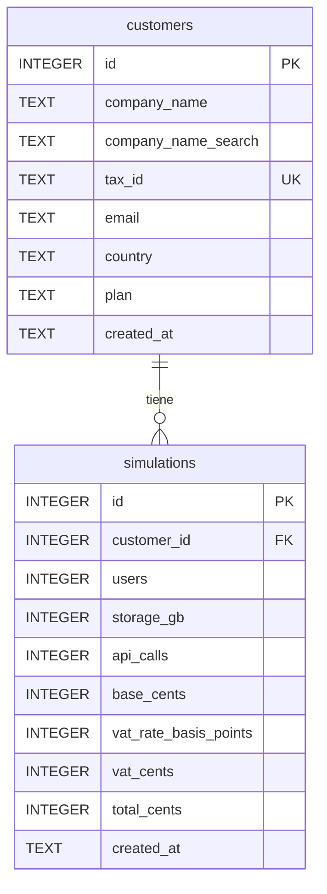

# 01 Modelo de datos

SQLite con better-sqlite3. Esquema en `api/src/infrastructure/db/schema.ts` (el SQL en una constante de texto, para que `tsc` lo incluya en `dist` sin pasos de copia), aplicado al arrancar (`CREATE TABLE IF NOT EXISTS`). Sin ORM ni herramienta de migraciones: dos tablas no lo justifican (ver ADR-005).



## DDL

```sql
PRAGMA foreign_keys = ON;

CREATE TABLE IF NOT EXISTS customers (
  id                  INTEGER PRIMARY KEY AUTOINCREMENT,
  company_name        TEXT    NOT NULL,
  company_name_search TEXT    NOT NULL,
  tax_id              TEXT    NOT NULL UNIQUE,
  email               TEXT    NOT NULL,
  country             TEXT    NOT NULL CHECK (length(country) = 2),
  plan                TEXT    NOT NULL CHECK (plan IN ('basic', 'pro', 'enterprise')),
  created_at          TEXT    NOT NULL DEFAULT (strftime('%Y-%m-%dT%H:%M:%fZ', 'now'))
);

CREATE INDEX IF NOT EXISTS idx_customers_name_search ON customers (company_name_search);

CREATE TABLE IF NOT EXISTS simulations (
  id          INTEGER PRIMARY KEY AUTOINCREMENT,
  customer_id INTEGER NOT NULL REFERENCES customers (id),
  users       INTEGER NOT NULL CHECK (users >= 1),
  storage_gb  INTEGER NOT NULL DEFAULT 0 CHECK (storage_gb >= 0),
  api_calls   INTEGER NOT NULL DEFAULT 0 CHECK (api_calls >= 0),
  base_cents  INTEGER NOT NULL CHECK (base_cents >= 0),
  vat_rate_basis_points INTEGER NOT NULL CHECK (vat_rate_basis_points >= 0),
  vat_cents   INTEGER NOT NULL CHECK (vat_cents >= 0),
  total_cents INTEGER NOT NULL CHECK (total_cents = base_cents + vat_cents),
  created_at  TEXT    NOT NULL DEFAULT (strftime('%Y-%m-%dT%H:%M:%fZ', 'now'))
);

CREATE INDEX IF NOT EXISTS idx_simulations_customer ON simulations (customer_id, created_at DESC);
```

## Decisiones

- **Importes en céntimos (INTEGER).** Evita errores de coma flotante (ADR-003).
- **`vat_rate_basis_points` en cada simulación.** Si el IVA de un país cambia, el historial sigue mostrando lo que se calculó en su día. Va en puntos básicos (2100 = 21 %) para admitir tipos con decimales, como el 25,5 % de Finlandia, sin dejar de ser entero.
- **`tax_id` único y normalizado.** La unicidad la garantiza la BD; el caso de uso comprueba antes para devolver un 409 claro, y la restricción cubre la condición de carrera: el repositorio traduce el error `SQLITE_CONSTRAINT_UNIQUE` de `tax_id` a `ApplicationError` `TAX_ID_ALREADY_EXISTS`, así también acaba en 409 y no en 500.
- **`company_name_search`.** Minúsculas y sin tildes, calculada en el dominio al crear. La búsqueda usa `LIKE` sobre esta columna y sobre `tax_id`, con parámetros (nunca concatenando texto).
- **CHECK en la BD.** Segunda barrera: el dominio valida primero, la BD impide datos imposibles aunque haya un bug.
- **Fechas en ISO 8601 UTC.** Se ordenan bien como texto y el frontend las formatea.
- **`PRAGMA foreign_keys = ON` en cada conexión.** SQLite lo trae desactivado por defecto; `connection.ts` lo activa al abrir, no solo en el esquema.
- **Sin borrado.** No hay `ON DELETE`: el borrado de clientes está fuera de alcance.

## Mapeo BD ↔ API

La BD usa `snake_case` y la API `camelCase`. La traducción vive solo en los repositorios SQLite.
