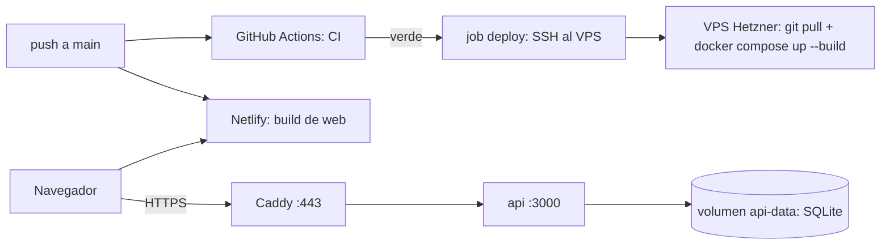

# 02 Despliegue, CI y CD

Cómo llega el código desde `main` hasta los dos sitios públicos, y los pasos que se hacen a mano una sola vez.

&nbsp;

## Piezas



- **Web:** Netlify construye `web/` en cada push a `main`, con la configuración de `netlify.toml`. `VITE_API_URL` se define en el panel de Netlify.
- **Api:** en el VPS, con Docker Compose. Dos servicios:
  - `api`, la imagen de `api/Dockerfile`;
  - `caddy`, que da HTTPS con un certificado automático y reenvía a `api:3000` (ADR-009).
- **Datos:** el archivo SQLite vive en el volumen `api-data`, montado en `/data`. Sobrevive a reinicios y a nuevas versiones de la imagen.

&nbsp;

## Decisiones

- **Un `docker-compose.yml` para local y para el VPS**, con Caddy en el perfil `prod`:
  - en local, `docker compose up --build` levanta solo la api en `localhost:3000`;
  - en el VPS, `docker compose --profile prod up -d --build` añade Caddy.
- **El puerto 3000 se publica solo en `127.0.0.1`.** En el VPS no es accesible desde fuera: todo entra por Caddy (80 y 443).
- **`TRUST_PROXY=1` en el VPS**, porque hay un proxy delante (Caddy). Así el límite de peticiones ve la IP real del cliente y no la de Caddy. En local, sin proxy, se queda en 0.
- **La imagen se construye en el VPS** (`--build`), sin registro de imágenes. Es más simple y para una api pequeña sobra. Mejora futura: construirla en el CI y subirla a GHCR.
- **El CD solo despliega si el CI pasa:** el job `deploy` depende de los checks y solo corre en push a `main`.
- **Después de desplegar, el CD comprueba `https://{API_DOMAIN}/health`.** Si no responde, el job falla y se ve en GitHub.
- **SSH sin `StrictHostKeyChecking=no`:** la huella del VPS va en un secreto (`VPS_KNOWN_HOSTS`). Así un servidor que se haga pasar por el VPS no recibe la conexión.
- **Usuario `deploy` en el VPS**, no root, con una clave SSH solo para GitHub Actions. Está en el grupo `docker`, que en la práctica equivale a root: es lo que pide Docker sin modo rootless, y se asume para una demo.
- **El seed se lanza a mano, una vez:** `docker compose exec api node dist/seed.js` (`01-specs/03-datos-demo.md`).
- **Limitación conocida:** Netlify despliega la web en cada push aunque el CI falle. Mejora futura: desactivar el despliegue automático de Netlify y lanzarlo desde el CI.

&nbsp;

## Variables

| Dónde | Variable | Valor |
|---|---|---|
| VPS, `.env` | `API_DOMAIN` | dominio de la api, sin `https://` (por ejemplo, `saas-api.marcos-alvarez.dev`) |
| VPS, `.env` | `CORS_ORIGINS` | URL de la web en Netlify, sin barra final (por ejemplo, `https://saas-o-matic.netlify.app`) |
| VPS, `.env` | `TRUST_PROXY` | `1` |
| Netlify | `VITE_API_URL` | `https://{API_DOMAIN}` |
| GitHub, secretos | `VPS_HOST` | IP del VPS |
| GitHub, secretos | `VPS_USER` | `deploy` |
| GitHub, secretos | `VPS_SSH_KEY` | clave privada de despliegue |
| GitHub, secretos | `VPS_KNOWN_HOSTS` | salida de `ssh-keyscan -t ed25519 {IP}` |
| GitHub, variables | `API_DOMAIN` | el mismo que en el VPS |

`DATABASE_PATH` y `PORT` los fija el `Dockerfile` (`/data/saas-o-matic.sqlite` y `3000`).

&nbsp;

## Pasos a mano (una vez)

En un VPS de Hetzner con Ubuntu 24.04 limpio:

1. **Firewall de Hetzner:** entrada abierta solo en 22, 80 y 443.
2. **DNS:** registro `A` de `saas-api` a la IP del VPS. Comprobar con `nslookup saas-api.marcos-alvarez.dev`.
3. **Sistema**, como root:
   ```
   apt update && apt upgrade -y
   curl -fsSL https://get.docker.com | sh
   adduser --disabled-password --gecos "" deploy
   usermod -aG docker deploy
   ufw allow OpenSSH && ufw allow 80 && ufw allow 443 && ufw --force enable
   ```
4. **Clave de despliegue**, en tu ordenador:
   ```
   ssh-keygen -t ed25519 -f saas-o-matic-deploy -N "" -C "github-actions"
   ```
   El contenido de `saas-o-matic-deploy.pub` va en `/home/deploy/.ssh/authorized_keys` del VPS (carpeta `700`, archivo `600`, dueño `deploy`).
5. **Repo y `.env`**, como `deploy`:
   ```
   git clone https://github.com/marcosAlvarezCalabria/Saas-o-matic.git ~/saas-o-matic
   cd ~/saas-o-matic && cp .env.example .env && nano .env
   ```
6. **Primer arranque:**
   ```
   docker compose --profile prod up -d --build
   docker compose ps
   curl https://saas-api.marcos-alvarez.dev/health
   docker compose exec api node dist/seed.js
   ```
7. **GitHub:** los secretos y la variable de la tabla, en *Settings → Secrets and variables → Actions*.
8. **Netlify:** comprobar `VITE_API_URL` y lanzar *Trigger deploy*.

&nbsp;

## Registro de cambios

- v0.1: despliegue con Docker Compose y Caddy en el VPS, Netlify para la web, CI y CD con GitHub Actions.
