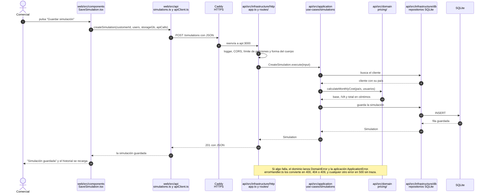

# Prompt 11b · README: recorrido de una petición

**Para:** Codex

**Fecha:** 2026-11-25

**Objetivo:** que el README enseñe, con un diagrama, por qué carpetas pasa una petición y cómo vuelve la respuesta.

&nbsp;

**Por qué está escrito así**

Un diagrama de secuencia en Mermaid, que GitHub dibuja solo. Cada columna es una carpeta real del repo, así que el diagrama también sirve de mapa: quien quiera leer el código sabe por dónde empezar.

Se usa un caso concreto, guardar una simulación, porque pasa por todas las capas: validación de la forma, dominio (tramos e IVA), repositorio y BD. Los errores van en una nota aparte, para no llenar el dibujo de flechas.

&nbsp;

---

~~~
Lee AGENTS.md. No toques nada fuera de README.md.
Haz solo este prompt y para.

1. En README.md, justo debajo del título "## Arquitectura y decisiones" y
   antes de su primera viñeta, inserta el bloque de abajo, tal cual.
2. Comprueba que existen todos los archivos y carpetas que nombra. Si
   alguno no existe, no lo cambies: para y avísame.

Commit: docs: recorrido de una petición en el README
~~~

---

&nbsp;

## Bloque para el README

~~~markdown
### Recorrido de una petición

Así viaja "Guardar simulación" por las carpetas del proyecto. Cada capa solo conoce a la de debajo, y solo `errorHandler.ts` sabe de códigos HTTP.

| Capa | Carpeta | Qué hace | Conoce a |
|---|---|---|---|
| Interfaz | `web/src/components`, `pages`, `hooks` | pinta y recoge lo que hace el usuario | `web/src/api` |
| Cliente HTTP | `web/src/api` | el único sitio del front que habla con el exterior | — |
| HTTP | `api/src/infrastructure/http` | rutas, forma de la entrada y traducción de errores | `application` |
| Aplicación | `api/src/application` | un caso de uso por acción; define los puertos | `domain` y `ports` |
| Dominio | `api/src/domain` | reglas puras: tramos, IVA, NIF | nada |
| Datos | `api/src/infrastructure/db` | implementa los puertos con SQLite | `application/ports` |
~~~
